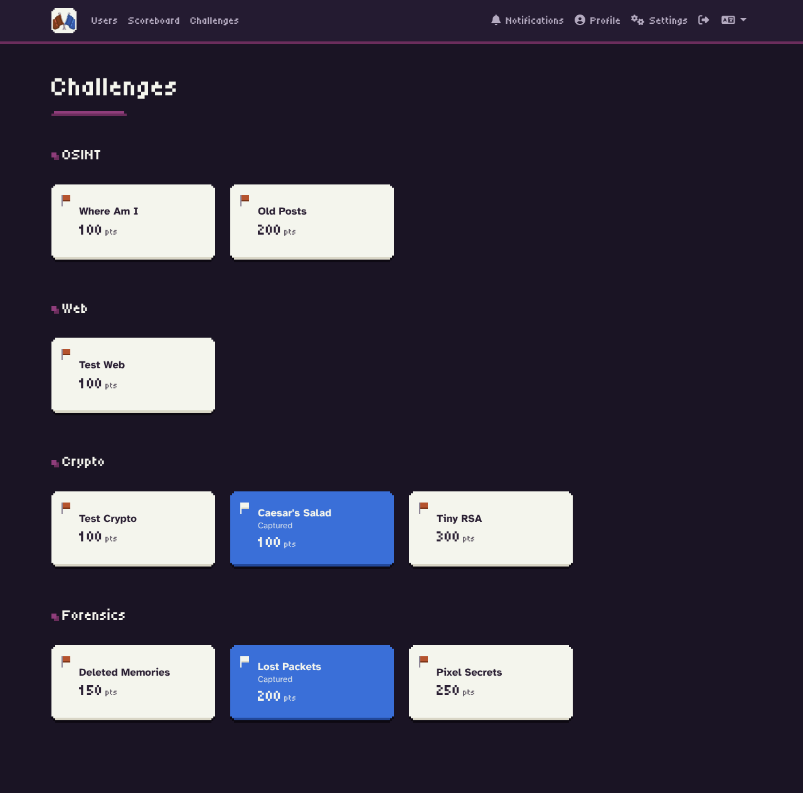
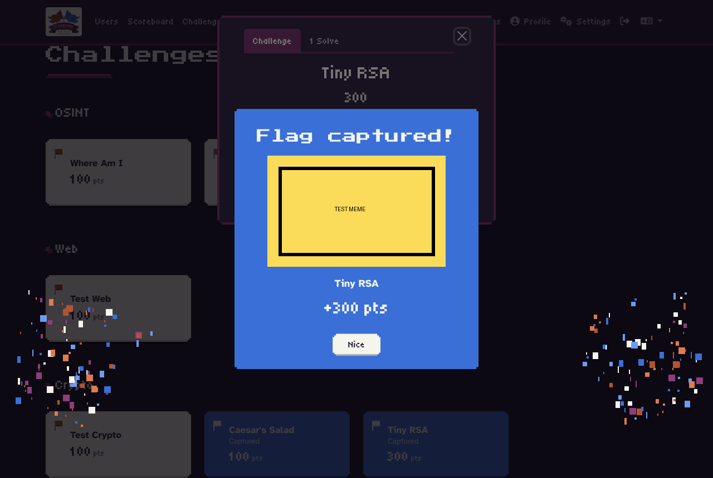
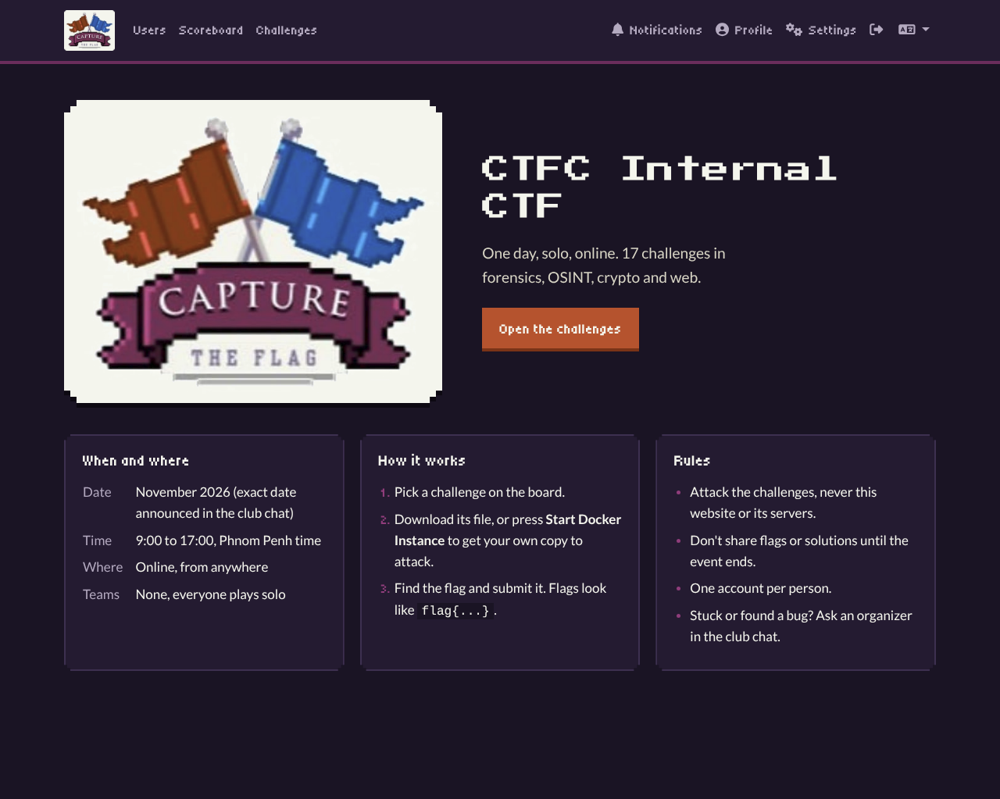
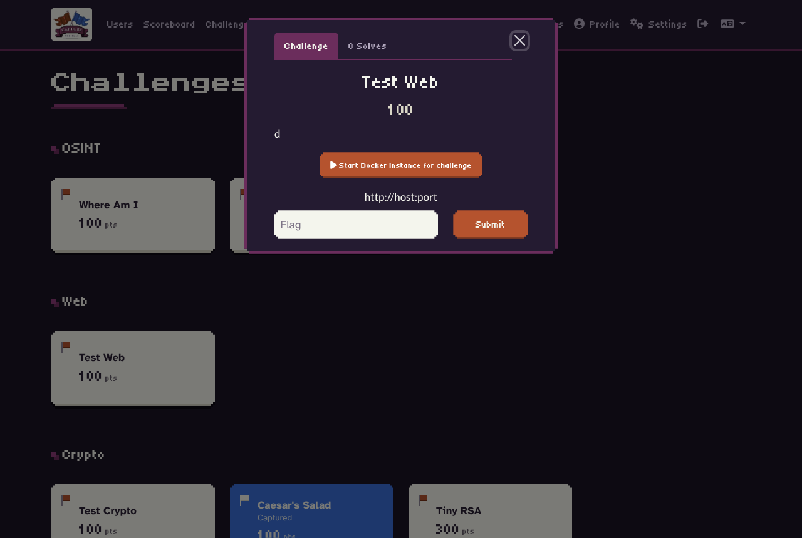
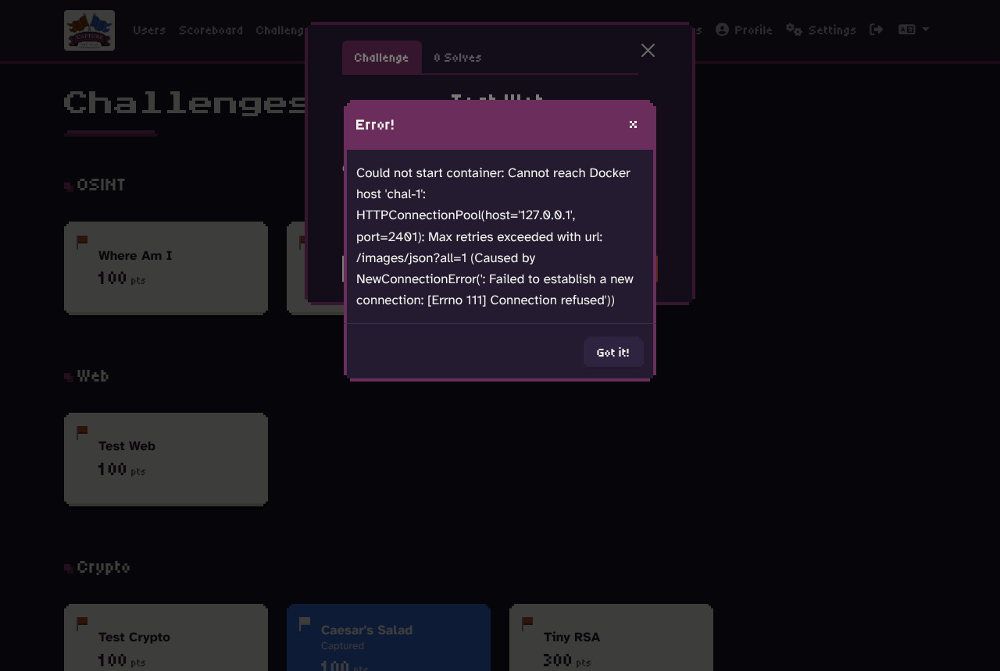
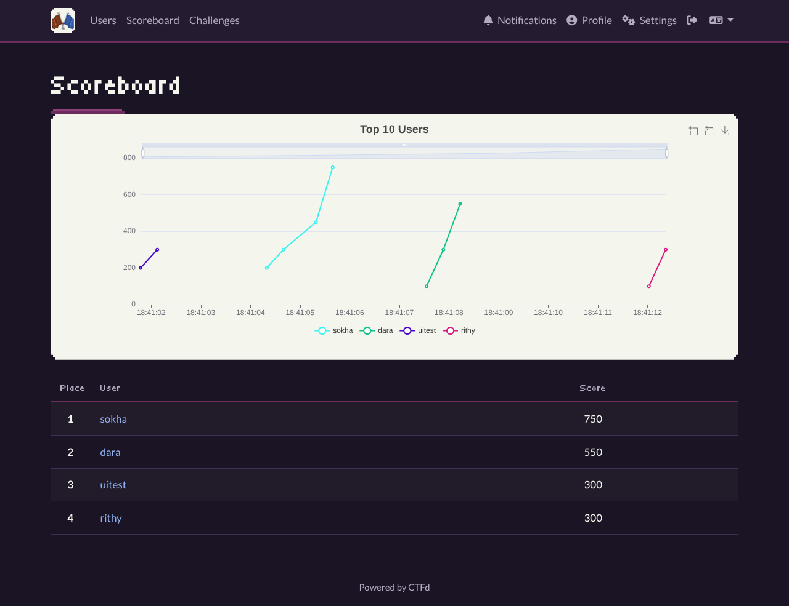

# CTFC branding for CTFd

Club look for the platform, built from the club logo. Everything is applied from the admin panel, so there's no theme to install and nothing to rebuild. A fresh CTFd (for example the ATC install) takes about 5 minutes to set up.



## Files

| File | Goes to |
|---|---|
| `ctfc-logo.png` | Admin > Config > Logo (navbar) and the home page |
| `ctfc-badge.png` | spare: flags-only crop |
| `favicon.ico` | Admin > Config > Logo > Small Icon (browser tab), full logo |
| `theme-header.html` | Admin > Config > Theme > Theme Header |
| `index-page.html` | Admin > Pages > `index` |
| `icon-180.png`, `icon-512.png` | spare sizes (phone home screen, social posts) |

## Look

- **Colors:** taken from the logo.
  - Night-purple background.
  - Plum for headings and modal bars.
  - **Red** means not solved yet; **blue** means captured, like the two flags.
  - Cream challenge cards, the same cream as the logo sticker.
- **Fonts:**
  - Press Start 2P (chunky arcade) for big page titles.
  - Press Start 2P, small, for the top bar.
  - Tiny5 (pixel) for buttons, section titles and points.
  - Atkinson Hyperlegible for body text and the flag input, so `0/O` and `1/l` are easy to tell apart.
- **Shapes:** stepped pixel corners and hard pixel shadows, matching the pixel-art logo.
- **Dark mode only:** the light/dark switch is hidden.
- **Correct flag:** a "Flag captured!" popup with the challenge name and points, pixel confetti in the club colors, and a random meme.
  - Memes go in the plugin: `docker_challenges/assets/memes/solved.png`, `solved-1.png` ... `solved-20.png`. No meme files = popup without an image.
  - Turns off the animation for players who set "reduce motion" on their device.



## Apply it (fresh CTFd)

1. **Theme.** Admin > Config > Theme: set the theme to **core-beta** (the default in 3.7) and Save.
2. **Logo and favicon.** Admin > Config > Logo:
   - Logo: upload `ctfc-logo.png`.
   - Small Icon: upload `favicon.ico`.
   - Save.
3. **Theme header.** Admin > Config > Theme > Theme Header: paste all of `theme-header.html` and Save.
4. **Home page logo.**
   - Go to Admin > Pages, open any page editor and click **Media Library**, then upload `ctfc-logo.png`.
   - Copy its URL. It looks like `/files/3f2a.../ctfc-logo.png`.
   - Don't upload it to a challenge's Files tab: those files are only served to people who can see that challenge.
5. **Home page.**
   - Go to Admin > Pages and open `index` (create it with route `index` if it doesn't exist).
   - Switch the editor to HTML and paste `index-page.html`.
   - Replace `LOGO_URL` with the URL from step 4.
   - Edit the date and rules text, then Save.
6. **Check.** Open the site in a private window. You should see:
   - the logo in the navbar,
   - the flag favicon,
   - cream challenge cards.

   If the cards look default, the Theme Header didn't save, or the theme isn't core-beta.

### Or with one script

`apply.sh` does steps 1 to 5. Edit the date in `index-page.html` first, because running it again overwrites the home page.

```bash
URL=http://localhost:8000 TOKEN=ctfd_xxx ./apply.sh
```

### Same thing from the command line

Useful when rebuilding. You need an admin API token (Settings > Access Tokens).

```bash
URL=https://ctf.example.com; TOKEN=ctfd_xxx
H="Authorization: Token $TOKEN"

# upload the logo, print its location
curl -s -H "$H" -F file=@ctfc-logo.png -F type=page $URL/api/v1/files | jq -r '.data[0].location'

# theme header (needs jq)
jq -n --rawfile h theme-header.html '{theme_header:$h}' \
  | curl -s -X PATCH -H "$H" -H 'Content-Type: application/json' -d @- $URL/api/v1/configs
```

Logo and favicon are easiest in the admin panel.

## Notes

- **Fonts come from Google Fonts.** If they don't load (blocked network, offline), the page falls back to system fonts and still works. To self-host them, upload the font files and swap the `<link>` for `@font-face` rules.
- **Plugin popups** (start, stop, memes) are restyled by the same header. No plugin change is needed.
- **Score chart:** CTFd draws the chart's text in dark colors, so the chart sits on a cream plate to stay readable.
- **Changing colors:** all colors are variables at the top of `theme-header.html` (`--ctfc-red`, `--ctfc-blue`, ...). Change them there only.
- **Undo:** clear the Theme Header field and the page goes back to stock core-beta.

## Previews

| Home | Challenge open (instance running) |
|---|---|
|  |  |
| **Plugin popup** | **Scoreboard** |
|  |  |

Mobile: [previews/home-mob.png](previews/home-mob.png)
